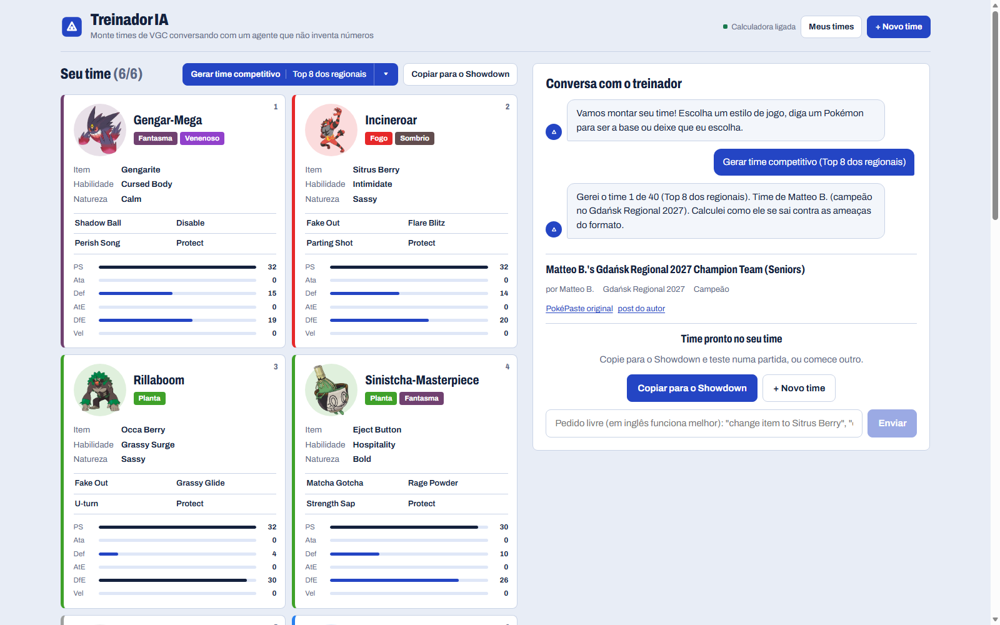
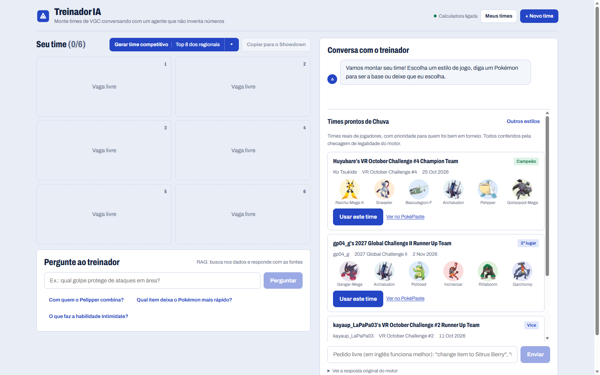

<h1 align="center">Treinador IA</h1>

<b>Monte times competitivos de Pokémon VGC com um agente de IA local que não inventa números</b> 
Agente LangGraph · RAG com busca híbrida · LLM local (Ollama) · cálculo de dano verificado · interface em português

> Projeto de **Paulo Henrique Batista de Jesus**. Este repositório é a vitrine do projeto: o código-fonte é privado.
> Se quiser ver o código, fale comigo que eu dou acesso.

## O que faz

**Gerar time competitivo.** Um clique coloca um time inteiro, de jogadores reais, pronto para copiar para o Pokémon Showdown. Sem escolher estilo, vêm os times do **top 8 dos regionais mais recentes**; com a setinha, escolhe-se o estilo (chuva, sol, Trick Room, Tailwind...). Cada clique traz o próximo time, sem repetir.

**Times prontos por estilo.** Três times reais por vez, com prioridade para quem foi bem em torneio. A lista é filtrada: clima misturado fica de fora, repostagens do mesmo time aparecem uma vez só e todo time passa por uma checagem de legalidade do formato. Ao escolher, aparecem a análise de ameaças e o código para importar o time direto no jogo.

**Montar do zero com o treinador.** Slot por slot, o agente sugere Pokémon legais no formato, monta a build completa (item, habilidade, natureza, golpes e pontos) com variações tiradas de times reais e, no fim, analisa o time contra os Pokémon mais usados: quem você nocauteia, quem segura e onde não há resposta.

**Pergunte ao treinador (RAG).** Perguntas abertas como "como eu uso o Pelipper?" ou "qual item deixa o Pokémon mais rápido?" são respondidas com base nos dados do projeto, mostrando os trechos usados. A resposta aparece enquanto a IA escreve.

## Onde está a IA, e onde ela não está

| Parte | Quem faz |
|---|---|
| Entender o pedido em texto livre | LLM local (`qwen2.5:7b` no Ollama), que só extrai a intenção em JSON |
| Conduzir a montagem (vazio → 1 Pokémon → vários → completo) | Agente **LangGraph** com estado salvo em SQLite |
| Legalidade, dano, velocidade e confrontos | Código determinístico e a calculadora oficial do Showdown (`@smogon/calc`) |
| Responder perguntas abertas | **RAG**: busca nos dados e a IA escreve só com os trechos encontrados |

A IA propõe, as ferramentas decidem: ela nunca afirma que um golpe é legal ou que um ataque nocauteia. Isso sempre vem de cálculo.

## Como o RAG funciona

1. **Documentos:** cerca de 1.100 textos curtos, um assunto cada. São golpes, itens e habilidades legais no formato, um resumo de "como usar" cada Pokémon (montado a partir de 925 times de torneio e da comunidade) e dicas escritas à mão.
2. **Embeddings:** cada texto vira um vetor com o `bge-m3`, que é multilíngue: a pergunta em português acha o texto em inglês.
3. **Busca híbrida:** junta a semelhança de sentido (vetor) com a palavra exata, filtra por tipo ("item", "golpe"), expande termos do português para os do jogo ("rápido" → Speed) e corrige erros de digitação ("pepiler" → Pelipper).
4. **Resposta:** a IA escreve só com os trechos encontrados, cita a fonte e copia os números como estão nos dados. Quando os dados não têm a resposta, ela diz que não sabe.

## Dados

- **Times:** 925 times da Reg M-C (VGCPastes) e estatísticas de 9.189 times de torneio (Pikalytics), atualizados com os scripts do motor.
- **Regulation:** lida do calendário do formato, então o projeto acompanha a troca de regulation sem mudar código.
- **Catálogo extensível:** dá para adicionar times por texto do Showdown ou por link do PokéPaste.

## Tecnologias

| Área | Tecnologias |
|---|---|
| IA e agentes | LangGraph, LangChain, Ollama, qwen2.5:7b (LLM), bge-m3 (embeddings), RAG com busca híbrida |
| Back-end | Python, FastAPI, Pydantic, NumPy, SQLite, streaming NDJSON, uv |
| Front-end | React 18, TypeScript, Vite, CSS com tema claro e escuro |
| Cálculo | Node.js e `@smogon/calc` |
| Dados | VGCPastes, Pikalytics, MetaRoll, Smogon/Showdown, PokéAPI |
| Testes | pytest (com LLM falso para testar sem a IA) e TypeScript |

Tudo roda localmente: nenhuma conversa ou dado do usuário sai do computador.

## Créditos

- **Motor de recomendação:** [pokemon-champions-agents](https://github.com/vuhcl/pokemon-champions-agents), de Vu Chu-Le, licença MIT. O agente, as ferramentas de legalidade e cálculo e os scripts de dados são dele. Este projeto construiu em volta dele a interface web em português, a API, os times prontos, o botão de gerar time e o RAG.
- **Artes e tipos dos Pokémon:** [PokéAPI](https://pokeapi.co).
- **Times:** comunidade [VGCPastes](https://twitter.com/VGCPastes) e [Pikalytics](https://www.pikalytics.com).

Projeto de fã, sem ligação com a Nintendo, a Game Freak ou The Pokémon Company.

© 2026 Paulo Henrique Batista de Jesus. Todos os direitos reservados para o conteúdo deste repositório.
